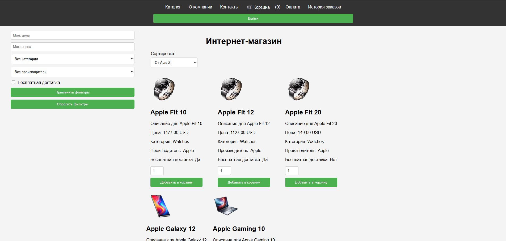
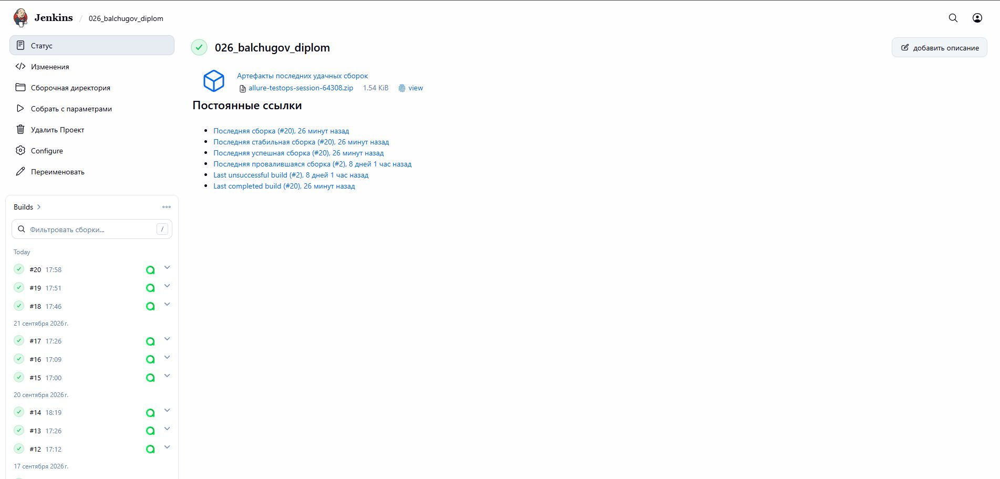

# Автоматизация тестирования [Demoshopping](https://qa.demoshopping.ru/)



Автоматизация функционального тестирования веб-приложения Demoshopping.
Проект включает UI- и API-тесты, проверки позитивных и негативных сценариев, а также валидацию структуры API-запросов и
ответов.

## Используемые технологии

* **Python** — язык, на котором написаны тесты и вспомогательный код.
* **Pytest** — запускает тесты, предоставляет фикстуры для подготовки окружения и позволяет группировать проверки.
* **Selenium WebDriver** — управляет браузером и выполняет UI-сценарии на сайте.
* **Selenium Page Factory** — помогает организовать страницы сайта как Page Object-классы и описывать их элементы.
* **Requests** — отправляет HTTP-запросы для API-тестов.
* **JSON Schema** — проверяет структуру и типы данных в ответах API.
* **Allure** — собирает шаги и вложения тестов и формирует отчёт о запуске.
* **Selenoid** — запускает браузеры удалённо в контейнерах; проект также получает оттуда видео выполнения UI-тестов.
* **python-dotenv** — загружает настройки и адреса сервисов из файла `.env`.

## Что проверяем

### API

* ✅ Регистрация пользователя
* ✅ Авторизация пользователя
* ✅ Получение списка товаров
* ✅ Добавление товара
* ✅ Изменение товара
* ✅ Удаление товара
* ✅ Валидация тела запроса
* ✅ Валидация ответа API по JSON Schema
* ✅ Проверка HTTP status code

### WEB

* ✅ Регистрация пользователя
* ✅ Авторизация пользователя
* ✅ Работа с каталогом товаров
* ✅ Фильтрация товаров по цене, производителю, категории
* ✅ Проверка отображения товаров
* ✅ Проверка цен товаров

## Запуск проекта

Установить зависимости:

```bash
pip install -r requirements.txt
```

При первом запуске скопируйте `.env.example` в `.env` в корне проекта и заполните настройки.
Файл `.env` исключён из Git, а `.env.example` содержит названия переменных без учётных данных.

- `API_USERNAME`, `API_PASSWORD` — данные существующего пользователя для API-авторизации.
- `API_REGISTRATION_USERNAME`, `API_REGISTRATION_PASSWORD` — отдельные данные для API-регистрации.
  Выберите свободный логин: тест создаёт этого пользователя и затем удаляет его.
- `UI_USERNAME`, `UI_PASSWORD` — данные существующего пользователя для UI-авторизации.
  Этот пароль также используется для регистрации нового UI-пользователя с генерируемым логином.
- `SELENOID_URL`, `SELENOID_LOGIN`, `SELENOID_PASS` — настройки удалённого браузера Selenoid.

## [Jenkins](https://jenkins.qa.guru/job/026_balchugov_diplom/)



Автоматизированные тесты запускаются в Jenkins.
В рамках сборки выполняются UI- и API-тесты, после чего формируется Allure Report.

## Allure report


Allure используется для формирования наглядных отчётов о результатах выполнения автотестов.

В отчёте доступны:

- результаты выполнения тестов;
- шаги тестов;
- время выполнения;
- вложения.

Для UI-тестов дополнительно сохраняются скриншоты, HTML страницы, логи браузера и видео выполнения теста.

## [Allure TestOps](https://allure.qa.guru/project/5378/launches)


Результаты автоматизированных тестов передаются в Allure TestOps, где можно отслеживать историю запусков, результаты
тестов и их структуру.
